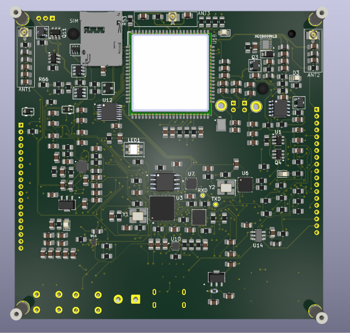
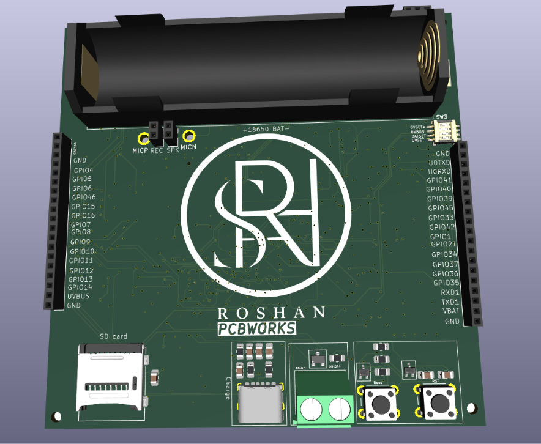

# ⚡ KiCad Projects Portfolio
 
A collection of electronics projects I designed in **KiCad**: schematics, PCB layouts, 3D models and, for many of them, Gerber files. I use it to learn by building, and every project here taught me something, including the mistakes. New projects get added as I go.
 


 
---
 
## 🌟 Featured: 4G GPS Tracker (4-layer)
 
[**Open the project folder →**](./4G-GPS-Tracker/)
 
My biggest and most complex design so far: a 4-layer 4G GPS tracker board with an ESP32-S3 and a 4G modem with built-in GNSS. I redrew the whole schematic by hand as hierarchical sheets, assigned every footprint and 3D model, then placed and routed the full board.
 
> **This is a design-only project.** It is based on the public Waveshare ESP32-S3-SIM7670X-4G schematic, which I redrew in KiCad. It is not an original circuit design, and I have not ordered, built or tested the board.
 
<!-- Add your images in 4G-GPS-Tracker/docs/ and keep these names, or change the paths -->


 
### What is on the board
 
- ESP32-S3 and a SIM7670X 4G modem with GNSS
- Battery charging and protection (ETA6098 charger, DW01 + 8205 protection), solar charge input (CN3791), MAX17048 fuel gauge
- USB-C, 18650 battery holder, SIM slot, microSD card, camera connector, MEMS microphone
- 3 u.FL antenna connectors (4G, GNSS, Wi-Fi/BT)
- W25Q128 flash, TXB0104 level shifter, CH343P USB-UART, push buttons, a DIP switch and pin headers
### Numbers
 
| | |
|---|---|
| Layers | 4 |
| Nets | 285 |
| Pads | 1000 |
| Vias | 564 |
| Capacitors / resistors | 90+ / 84+ |
| Footprint size for passives | 0805 (2012 metric) |
| KiCad version | 10.0.3 |
 
### Stackup and routing choices
 
| Layer | Use |
|---|---|
| F.Cu | Components, signals and the RF lines |
| In1.Cu | Solid GND plane |
| In2.Cu | Signal routing (no power pour, power is routed with traces) |
| B.Cu | Signals and the battery connections |
 
- The antenna lines are routed as **50 Ω microstrip** on F.Cu above the solid In1 GND plane. The width is about 0.35 mm for a 0.2 mm dielectric. This is a **calculated** value, not a measured one.
- Every GND pad gets a via straight down to the In1 plane, so the board has no long GND traces.
- Via sizes: 0.6 / 0.3 mm in general, and 0.5 / 0.25 mm in tight areas such as the camera fan-out.
- The crystal has no traces under it, and the SPI flash sits close to the ESP32.
### Status
 
- All nets are routed (0 unrouted).
- The KiCad DRC window crashed on this board, so I run DRC from the command line with `kicad-cli`, using a small script (in [`tools/`](./tools/)). It groups the violations by type, so I can see the real problems first.
- <!-- UPDATE this line after your final DRC run --> First DRC run: 0 unconnected items and 511 violations. Most of them were a via-size rule setting and cosmetic items (silkscreen, solder mask slivers). I am cleaning them up. A few minor violations may remain, so please **run DRC yourself before judging the layout**.
### Known limits
 
I want to be upfront about these:
 
- Power traces are 0.25 to 0.35 mm wide to fit the dense layout. A production board would use 1 mm or wider traces (or pours) for the modem supply, and several vias per layer change.
- A few vias are placed inside pads. A real factory would need filled and capped vias, or the vias would move beside the pads.
- The GNSS connector is far from the modem's GNSS pad, so that trace is longer than it should be. A final layout would move the connector closer.
- The camera part (U15) does not match yet. The schematic uses a 24-pin socket, and the footprint is the bare camera package.
- Nothing is simulated or measured: not the RF lines, not the power rails.
### What I learned
 
The first netlist update gave 47 errors from wrong footprints and missing library names. ERC complained about power outputs until I fixed the pin types on the GND pins. My first GNSS antenna trace was 68 mm long and ran on the back layer under the modem, so I deleted it and routed it again on the top layer. Along the way I learned about microstrip width, via sizes, fan-out under a camera footprint and why vias do not belong in small pads. Next I want to learn LTspice, to simulate the power blocks and filters.
 
**Credit:** schematic reference is the Waveshare ESP32-S3-SIM7670X-4G board design.
 
---
 
## 📖 About
 
The projects here go from simple beginner circuits to a 4-layer board with a 4G modem. Each one reflects real learning, including mistakes, revisions and improvements over time.
 
**Skills practiced**
 
- Schematic capture and symbol assignment, hierarchical multi-sheet schematics
- Footprint selection and custom footprint and symbol library creation
- PCB layout, trace routing, copper pours, 4-layer stackups
- RF trace width for 50 Ω microstrip (calculated)
- DRC, ERC and design rules, including command-line DRC
- Gerber export for fabrication
- 3D model linking and visualisation
---
 
## 🗂️ All projects
 
### ⚙️ Power conversion and batteries
 
| Project | What it is |
|---|---|
| [3V to 40V DC Booster](./3v%20to%2040v%20DC%20booster/) | Boost converter that steps 3 V up to as much as 40 V |
| [60W SMPS](./60W%20SMPS/) | 60 W switch-mode power supply |
| [DC-DC Buck Converter](./DC-DC%20Buck%20converter/) | XL4015 step-down converter with constant-current / constant-voltage output |
| [Battery Desulfator](./Battery%20Desulfator%20circuit/) | NE555 pulse generator driving an IRF244V MOSFET, for lead-acid batteries |
| [Battery Powered Bench Power Supply](./Battery%20powered%20bench%20power%20supply/) | Bench power supply that runs from batteries |
| [Li-ion 4S BMS](./Li-ion%204S%20BMS/) | Battery management board for a 4-cell Li-ion pack |
| [TP4056 Module](./tp4056%20module/) | TP4056 Li-ion battery charger module |
| [Multi-rail PDB](./multirail%20PDB/) | 24 V to 12 V, 5 V and 3.3 V buck cascade with a TI eFuse on each rail |
| [YX850 Power Failure Switching Module](./YX850%20Power%20Failure%20Automatic%20Switching%20Module/) | Automatic switch-over module for power failures |
| [Mini Inverter](./mini%20inverter/) | DC to AC inverter using IR2153 half-bridge gate drive |
| [Induction Heater](./inductionheater/) | High-frequency switching circuit that heats metal with a work coil |
 
### 🔧 Motor drivers and switching
 
| Project | What it is |
|---|---|
| [1-Channel Relay Driver](./1channelrelay/) | MMBT2222A switching a relay, with a flyback diode and a GND pour |
| [3-Phase BLDC Motor Controller](./3-Phase%20BLDC%20%28Brushless%20DC%29%20Motor%20Controller/) | Hierarchical design with IR2104 gate drivers and a 3-phase MOSFET bridge |
| [A4988 Stepper Motor Driver](./A4988%20Stepper%20Motor%20Driver/) | Stepper motor driver board based on the A4988 |
| [L298 Motor Driver](./L298%20motor%20driver/) | Dual H-bridge driver for two DC motors or one stepper motor |
| [Dual VNH2SP30 Motor Driver](./Dual%20VNH2SP30%20Motor%20Driver%20Carrier%20MD03A/) | Carrier board for the dual VNH2SP30 high-current motor driver |
| [Solid-state Relay](./Solid-state%20relay/) | Solid-state relay circuit |
 
### 📡 Wireless, GNSS and radio
 
| Project | What it is |
|---|---|
| [4G GPS Tracker](./4G-GPS-Tracker/) | **Featured.** 4-layer board with ESP32-S3 and a 4G modem with GNSS |
| [Embedded GSM_GPS IoT Controller](./Embedded%20GSM_GPS%20IoT%20Controller/) | IoT controller board with GSM and GPS |
| [GSM_GPS Embedded Development Board](./GSM_GPS%20Embedded%20Development%20Board/) | Development board with GSM and GPS |
| [HC-06 Bluetooth Module](./HC-06%20BLUETOOTH%C2%AE%20Module/) | Breakout board for the HC-06 Bluetooth serial module |
| [Digital Radio Receiver](./microcontroller-controlled%20digital%20radio%20receiver/) | Microcontroller-tuned FM/AM radio receiver |
| [Portable FM Radio Receiver](./portable%20FM%20radio%20receiver/) | Battery-powered FM radio with an M6955 receiver IC and an Arduino Pro Mini |
| [FMCW Radar](./FMCW%20Radar/) | FMCW radar board |
| [Wake on LAN](./Wake%20on%20LAN/) | Wake-on-LAN board |
 
### 🧠 Microcontroller and computer boards
 
| Project | What it is |
|---|---|
| [Arduino Uno R3 Clone](./Arduino%20R3/) | Clone of the Arduino Uno R3 with the ATmega328P |
| [STM32 Dev Board](./STM32%20DEV%20board/) | STM32 board with reset, boot selection, crystal and programming header |
| [ESP32 Demo Project](./esp32%20demo%20project/) | ESP32 module board exploring power, GPIO and boot strapping pins |
| [ESP32-S3](./ESP32-S3/) | ESP32-S3 based board |
| [ESP32 Drone](./esp32Drone/) | ESP32 flight controller with IMU, ESC outputs and USB-C, 4 layers |
| [Mini Drone](./minidrone/) | Small drone board |
| [Raspberry Pi Pico](./rasberry%20pi%20pico/) | Raspberry Pi Pico board design |
| [Raspberry Pi CM4 Carrier Board](./Raspberry%20Pi%20Compute%20Module%204%20Carrier%20Board/) | Carrier board for the Raspberry Pi Compute Module 4 |
| [Milk-V Duo Module](./Milk-V%20Duo%20Module/) | Board design for the Milk-V Duo |
| [LoFive](./LoFive/) | RISC-V board based on the open-source LoFive design |
| [USB to UART Converter](./USB2UART/) | USB-serial bridge board for programming and debugging microcontrollers |
 
### 🔬 Sensors, analog, instruments and basics
 
| Project | What it is |
|---|---|
| [ESP32 Oscilloscope and Function Generator](./esp32%20oscilloscope%20adn%20fucntion%20generator/) 🎓 | **Final year project.** Signal acquisition and signal generation on one ESP32 board |
| [Air Quality Sensor Board](./Air%20Quality%20Sensor%20Board/) | Air quality sensor with an MCU and a Tag-Connect SWD footprint |
| [DS3231 RTC Module](./DS3231%20RTC%20Module/) | Real-time clock breakout with battery backup |
| [SPO2 Pulse Oximeter](./SPO2/) | Red and IR LEDs with a photodetector for SpO2 and heart rate |
| [VL53L0X ToF Distance Sensor](./VL53L0X%20Time-of-Flight%20Distance%20Sensor/) | Breakout for the VL53L0X time-of-flight sensor |
| [LM386 Audio Amplifier](./LM386%20Based%20Audio%20Amplifier/) | Small audio amplifier built around the LM386 |
| [Hearing Aid](./hearingaid/) | Hearing-aid amplifier with an electret mic, BC547 transistor stages and a 16 Ω earpiece on 3 V |
| [LED Flasher](./LED%20flasher/) | Astable multivibrator LED flasher |
| [One Digit Up/Down Counter](./one%20digit%20updown%20counter/) | Up/down counter with a 7-segment display |
| [Traffic Light Controller](./Traffic%20light%20controller/) | Traffic light controller circuit |
 
---
 
## 📁 Repository structure
 
Each project has its own folder. Most contain:
 
```
<project-name>/
├── *.kicad_sch      # Schematic files
├── *.kicad_pcb      # PCB layout files
└── Gerber/          # Fabrication files, where exported
```
 
The featured project also has a `docs/` folder with the 3D images and a `tools/` folder at the repository root with the command-line DRC script.
 
---
 
## 🛠️ Tools
 
- **KiCad EDA** v10.0
- `kicad-cli` for command-line DRC
- Manufacturer data sheets for part selection
- KiCad 3D viewer for visual inspection
- Custom symbol and footprint libraries
---
 
## 📝 Note on quality
 
These projects document my learning openly. Some designs have flaws or open points, and I list them where I know them. I come back and improve designs as my knowledge grows, instead of hiding earlier work.
 
---
 
## 📄 License
 
Unless stated otherwise, the projects here are shared for education and as a portfolio. Designs that are based on other people's work (for example the Waveshare reference design) belong to their original authors, and I credit them in each project.
 
Feel free to open an issue or a discussion if you have suggestions or feedback.
 
